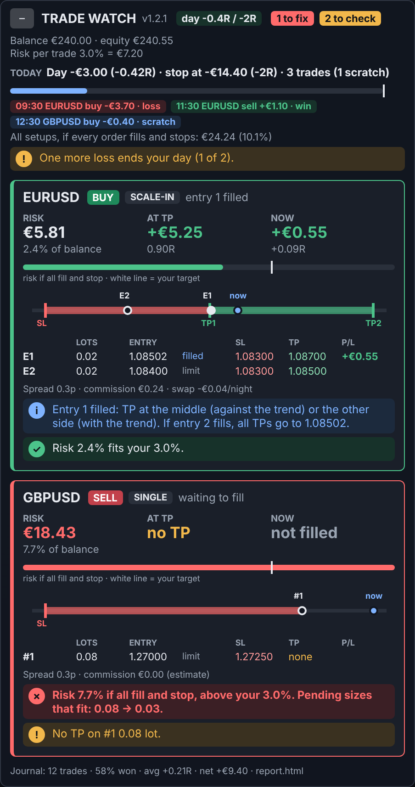
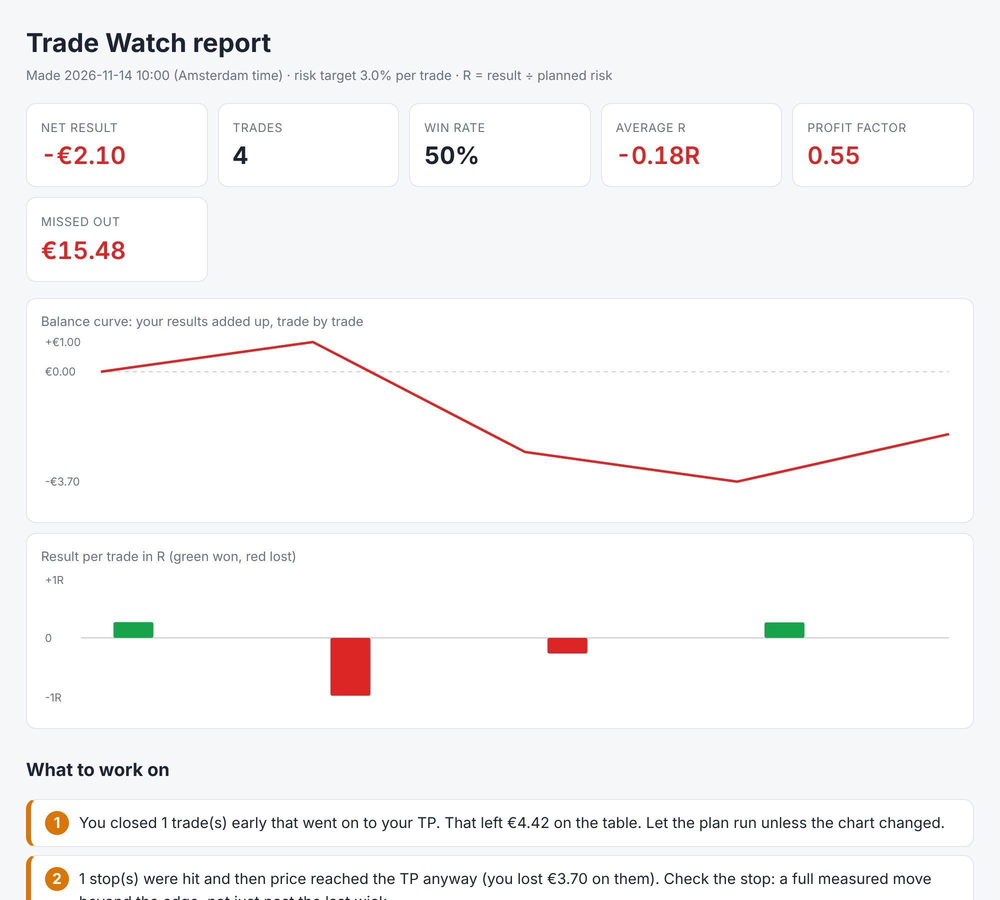

# cTrader cBots

Two cBots live here:

- **Trade Watch** (`TradeWatch.cs`): watches your own trades and never trades. Start here.
- **Trade Trainer Reader** (`TradeTrainerReader.cs`): trades the app's setups by itself. See further down.

---

# Trade Watch: keeps an eye on all your trades

A read-only cBot. It watches every pending order and open position on the account, on all
symbols, and checks them against your plan. It never places, moves or closes anything.

## Install (cTrader for Mac, same on Windows)
1. Open cTrader and go to **Algo** (left bar) > **cBots** > **New**.
2. Delete all the template text, paste all of `TradeWatch.cs`, and press **Build**. It should say "Build succeeded".
3. Click **+** next to Trade Watch to add an instance, pick any chart (EURUSD 15m is fine), and press **Start**.
4. cTrader asks to give the bot **full access**. Say yes: it's only used to write the journal files.

One instance is enough. It covers every symbol and both directions.

## What you see

*Preview drawn from the same panel data with made-up orders; in cTrader it looks the same apart from fonts.*

The header always shows your **daily stop as dots** (red = a loss today) and how many things are
**to fix** (red) or **to check** (yellow), also when the panel is folded with the **–** button.
Below it: balance, your 3% in money, and today's losses, trades and P/L.

Then one **card per setup**. A setup is one symbol plus one direction: EURUSD buys, EURUSD sells and
GBPUSD buys are three separate cards, so numbers never get mixed. The card's left edge is green, yellow or red
for its worst check. Each card shows:

- **RISK / AT TP / NOW** in big numbers: what you lose if everything fills and the stop is hit (money and % of balance),
  what you make at TP (and in R), and the P/L of what is filled (and in R)
- a **risk bar**: green up to your target, red above it; the white line is your target
- a **price ladder**: stop always on the left, TP on the right, red zone = risk, green zone = reward,
  open circle = pending entry, white dot = filled entry, blue dot = price now
- every order and position: lots, entry, filled or limit, SL, TP, P/L
- spread, commission (round trip) and swap per night
- the checks as coloured lines: green ✓ fine, blue i reminder, yellow ! worth a look, red ✗ act now

| Check | When |
|---|---|
| No stop / stop on the wrong side | red |
| No TP / TP on the wrong side | yellow / red |
| Stops differ inside one setup | yellow (your plan uses one shared stop) |
| Risk above your target (default 3%) | red, with the lot sizes that would fit |
| Range scale-in: entry 2 TP not at entry 1 | yellow |
| Range scale-in: entry 2 filled and TP not yet at entry 1 | red: "move TP to ..." |
| Range scale-in: stop closer than the plan (less than half the gap between entries beyond entry 2) | yellow |
| Spread more than 10% of the stop | yellow |
| A trade closed but its other order is still pending | red: cancel it? |
| Buys and sells open on one symbol | yellow (still shown separately) |
| Rollover within 60 minutes with positions open | yellow, with the swap in money |
| Daily stop: one loss left / reached / reached with orders still pending | yellow / red |

A new yellow or red check plays a sound, shows a popup and is written to the cBot **Log** once.

### How the numbers are worked out
- Risk of one order = stop distance in pips x pip value x volume + round-trip commission.
  Example: 0.02 lot EURUSD (2,000 units), stop 20 pips, EUR account at EURUSD 1.085:
  one pip on one unit is 0.0001 USD = 0.0000922 EUR, so 20 x 0.0000922 x 2,000 = EUR 3.69, plus commission.
- Pip value comes from cTrader at the moment the bot starts. Restart the bot once a day if the rate moves a lot.
- Commission: for open positions it's cTrader's own figure. For pending orders it's an **estimate**
  from your last trade on that symbol, and the panel says so if there was none.
- Swap per night uses the symbol's swap rates from cTrader (triple on the triple-swap day).
- Daily stop (default **Day down in R**): the day ends when its closed results add up to 2 risks down
  (1R = your risk % of the balance the day started with; at 3% of EUR 240 that's EUR 7.21, so the stop is at -EUR 14.42).
  Wins in between give room back, and there's no limit on the number of trades. The header shows a chip like "day -1.2R / -2R".
  The other rule, **Count losses**, stops after 2 losses (above 1% risk, else 3). A **scratch**, meaning a loss smaller than 20% of your
  risk per trade, never counts as a loss. Positions on the same symbol and direction that close within 5 minutes of each other
  count as one trade. Under the day line, each of today's trades is shown as a chip marked loss, scratch or win (and written to the Log). The trading day runs on Amsterdam time from midnight, and you can set another start hour.
  Positions on the same symbol and direction that close within 5 minutes of each other count as one trade.

## Journal and report
The files go in **Documents/TradeWatch** (you can pick another folder in the settings):

- `journal.csv`: one line per finished trade (a scale-in is one trade). It has the entries, lots, SL, TP,
  planned risk, result in money and R, commission, swap, how far the trade went your way at best (best R),
  how you exited (TP, SL, manual), and which rules were broken for more than a minute while it was open.
- `cancelled.csv`: orders you cancelled or that expired, and what they would have done.
- In the report, results within 0.2R of zero count as scratch: they are left out of the win rate and the losing streak.
- `report.html`: the same report as a coloured page with tiles, a balance curve and a bar per trade in R. Double-click it to open it in your browser.
- `report.md`: rewritten after every trade. It covers performance (win rate, average R, profit factor, losing streak),
  **what to work on** (the 3 things that cost you most), what went well,
  **what you missed out on**, rules broken, and results by setup type, symbol, hour, weekday and exit.

**Send `report.md` (and `journal.csv` if you like) to Claude** to go through it together. `report.html` is the one to read yourself.

What "missed out" means:
- **Closed early, then TP**: after a manual exit, price reached your original TP before your stop (checked over 24 hours).
- **Stopped out, then TP**: after a stop-out, price still went on to reach the TP. That usually means the stop was too close.
- **Cancelled orders**: whether the order would have filled, and then hit TP or the stop first.
- **Best point vs result**: how far trades went your way at best, compared with what you kept.

The checks need minute bars, so the bot has to be running. Trades closed while it was off are still
logged the next time it runs, but without the best point.

## Settings
| Setting | Default |
|---|---|
| Risk target per trade (% of balance) | 3 |
| Daily stop rule | Day down in R |
| Day down in R: stop when the day is down this many risks | 2 |
| Count losses: stop after (0 = auto) | 0 (2 above 1% risk, else 3) |
| Trading day starts at (hour, Amsterdam time) | 0 |
| Scratch: a loss smaller than this % of your risk per trade doesn't count | 20 |
| Sound / popup on a new warning | on / on |
| Warn before rollover (minutes) | 60 |
| Keep journal and report | on |
| Journal folder | empty = Documents/TradeWatch |
| Panel corner, font size | top left, 12 |

## Tests
`tests/` checks the math and the journal without cTrader: `cd ctrader/tests && dotnet run`.
They also run on GitHub for every change in `ctrader/`.

---

# Trade Trainer Reader

The "Reads the chart" Coach from Trade Trainer, ported to a cTrader cBot. It finds the
11 Al Brooks setups the app teaches (bull and bear) from closed bars only, and trades
them the way the app's auto-backtest does.

The C# engine was checked against the app on 24 generated charts (8 markets, 3
timeframes): all 1,709 setups identical — same setup, same bar, same entry, stop and target.

## Install
1. cTrader → **Algo** → **New cBot**, delete the template, paste all of `TradeTrainerReader.cs`, **Build**.
2. Add an instance per chart you want traded (symbol + timeframe), e.g. XAUUSD, US100.cash,
   EURUSD, USDJPY, GER40.cash, US500.cash, UKOIL.cash on 15m.
3. BTCUSD on weekends only: set **Days to open trades** = `Weekends_only`.

## Parameters
- **Risk per trade** — % of equity at risk if the stop is hit (default 1%).
- **Skip if spread >** — no new trade while the spread is wider than this share of ATR.
- **Cancel unfilled order after** — bars (default 6, as in the app).
- **Setups** — switch individual setups on or off.

## Test before trading
Backtest on several years of real data with your broker's spread and commission.
When the backtest stops, the log prints a per-setup report (trades, win rate, average R,
costs included). The rules were tuned on the app's generated charts and have never been
tested on real markets. Then run it on a demo account before any real money.
